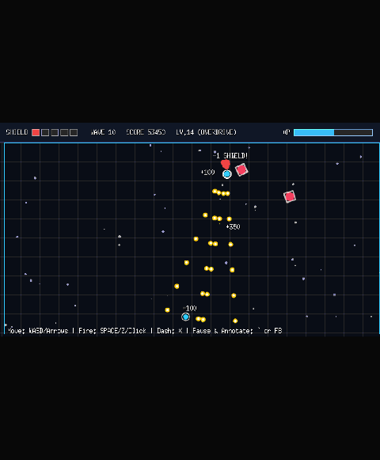
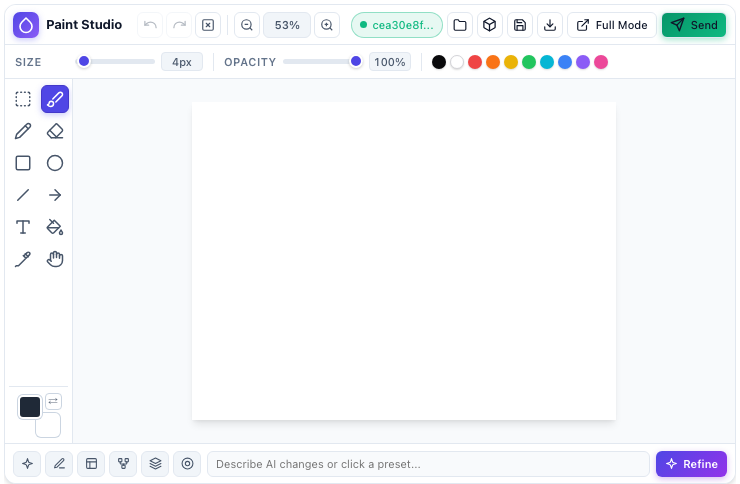
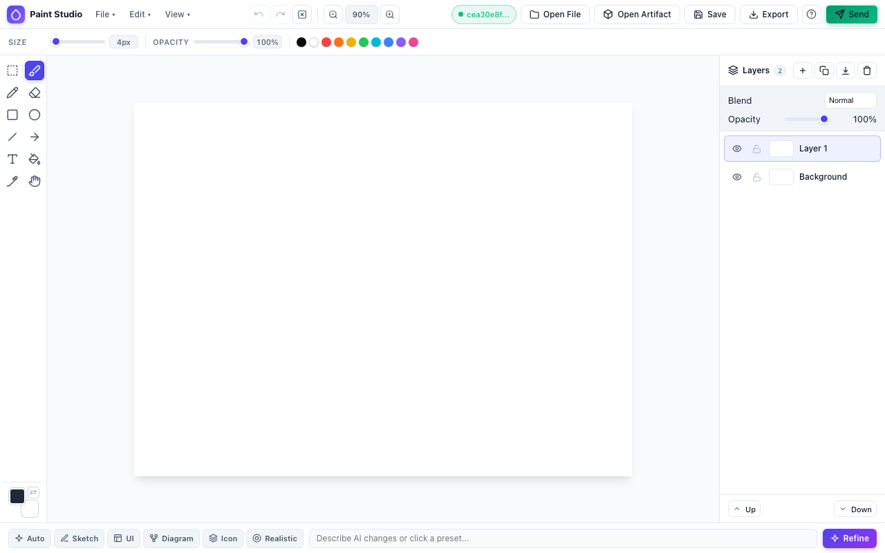
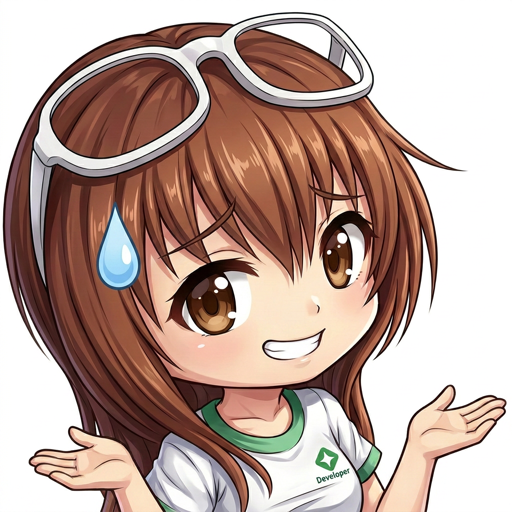

# Game Dev Starter Kit for Google Antigravity

Build, paint, compose, and playtest 2D games in Go with [Ebitengine](https://ebitengine.org/) and Google Gemini — right inside [Google Antigravity](https://antigravity.google).

What started as a collection of agent skills has grown into a complete **Game Dev Starter Kit** bundling **two Antigravity UI Extension plugins**, **12 specialized skills**, and a playable WebAssembly demo game:

1. 🎮 **[Antigravity 2D Game Studio (`agy-game-studio`)](plugins/agy-game-studio/README.md)** — Live 60 FPS Ebitengine WebAssembly **Playtest Studio** side-pane extension with a 10-second (250-frame) GPU DVR rewind buffer, visual bug annotation tools, 10s animated GIF export, and 11 end-to-end game development skills.
2. 🎨 **[Antigravity Paint Studio (`agy-paint-studio`)](plugins/agy-paint-studio/README.md)** — Interactive multi-layer drawing, pixel art, `.psd` editing, and Gemini AI image refinement studio that runs inline in chat, docked in the side pane, or as a custom viewer for `.psd` and raster image files.

---

## Visual Tour

### 1. Playtest Studio (`agy-game-studio`) — Live 60 FPS WASM & 10s DVR Bug Reporting

Compile any Go/Ebitengine game to WebAssembly (`GOOS=js GOARCH=wasm`) with one click and play it right next to your conversation. Press `F8` or `` ` `` at any moment to pause, scrub back through the **last 10 seconds of gameplay (250 frames @ 25 FPS)**, circle visual bugs, and send either a smart-cropped **📸 Frame** screenshot or a pure **🎞️ 10s GIF** clip straight to Antigravity chat.

| Live 60 FPS Gameplay in Side Pane | Pause, Scrub 10s DVR & Annotate Bugs |
| :---: | :---: |
|  |  |

<p align="center">
  
  <br />
  <em>Actual 10-second animated GIF89a clip captured by Playtest Studio's GPU DVR ring buffer during Wave 10 of <code>examples/playtest-demo</code> (Neon Bastion).</em>
</p>

### 2. Paint Studio (`agy-paint-studio`) — Multi-Layer Pixel Art, PSDs & AI Refinement

Sketch game concepts, draw pixel-art sprites, edit multi-layer Photoshop (`.psd`) files, and refine artwork with Gemini presets (**Pixel Art**, **Concept Art**, **Vector**, **3D Clay**, **Anime**, **Watercolor**, **Beautify**, **Notes**) without leaving your editor.

| Dockable Side-Pane Canvas | Full Multi-Layer `.psd` Workspace |
| :---: | :---: |
|  |  |

---

## User-Level Installation

Both `agy-game-studio` and `agy-paint-studio` ship with **prebuilt UI assets (`dist/`)** and run on Antigravity's bundled Node.js runtime and `sidecar_sdk`. As a user, **no `npm install` or frontend build step is required** — you only need Go (`1.26+` recommended) to compile your Ebitengine games to WebAssembly.

### Option A: Workspace-Scoped (Zero-Install via `.agents/plugins.json`)

This repository includes [`.agents/plugins.json`](.agents/plugins.json) pointing to `./plugins`:

```json
{
  "entries": [
    { "path": "plugins" }
  ]
}
```

Simply clone `game-dev-starter-kit` and open the folder in **Antigravity 2.0**, **Antigravity IDE**, or **Antigravity CLI (`agy`)**. Antigravity automatically discovers and loads both `agy-game-studio` and `agy-paint-studio` for this workspace.

### Option B: Global Install (Available Across All Workspaces)

Choose the installation method for your Antigravity surface to make both plugins available in every project on your machine:

#### 1. One-Command Starter Kit Installer (macOS / Linux)

Run the included installer script to link both `plugins/agy-game-studio` and `plugins/agy-paint-studio` into `~/.gemini/config/plugins/` and enable them:

```bash
./scripts/check_env.sh
./scripts/install_plugins.sh
```

#### 2. Antigravity CLI (`agy`)

Install either or both standalone plugins directly from GitHub in your shell:

```bash
agy plugin install https://github.com/danicat/agy-game-studio
agy plugin install https://github.com/danicat/agy-paint-studio
```

Or inside an interactive `agy` TUI session using `/plugin`:

```text
/plugin install https://github.com/danicat/agy-game-studio
/plugin install https://github.com/danicat/agy-paint-studio
```

#### 3. Antigravity 2.0 and Antigravity IDE (Manual Global Discovery Root)

Clone or symlink the plugins into Antigravity's global plugin discovery root (`~/.gemini/config/plugins/` on macOS/Linux, or `%USERPROFILE%\.gemini\config\plugins\` on Windows):

```bash
git clone https://github.com/danicat/agy-game-studio.git ~/.gemini/config/plugins/agy-game-studio
git clone https://github.com/danicat/agy-paint-studio.git ~/.gemini/config/plugins/agy-paint-studio
```

Or register the starter kit's `plugins/` folder globally in `~/.gemini/config/plugins.json`:

```json
{
  "entries": [
    { "path": "/path/to/game-dev-starter-kit/plugins" }
  ]
}
```

### Enabling & Opening the Studios

1. If you created or cloned a new plugin directory on disk, **restart Antigravity** so it discovers the new plugin directory on startup.
2. In **Antigravity 2.0** or **Antigravity IDE**, open **Customizations** in the left sidebar, select the **Installed** tab, and confirm **Antigravity 2D Game Studio** (`agy-game-studio`) and **Paint Studio** (`agy-paint-studio`) are enabled. (Or run `/plugin` in chat / `agy plugin enable <name>` in the CLI.)
3. Once enabled, Antigravity automatically starts and supervises both background sidecar servers (`agy-game-studio/studio` and `agy-paint-studio/studio`).
4. Trigger the studios and workflows in any conversation:
   - **`/vibe-game-developer`** — Start a new 2D game from scratch (design interview → `GDD.md` → Ebitengine architecture → procedural/Gemini assets → live WASM playtest).
   - **`/playtest-studio`** — Open **Playtest Studio** in the side pane (or click **⋮ → Extensions → Playtest Studio**).
   - **`/paint-studio`** — Open **Paint Studio** inline in chat and in the side pane (or click **⋮ → Extensions → Paint Studio**, or click any `.psd`, `.png`, `.jpg`, or `.webp` file).

### Configuring Gemini Credentials (Optional — for AI Art, Music & Refinement)

- **`nano-banana` & `lyria` (`agy-game-studio`)** accept either a Gemini API key or Vertex AI Application Default Credentials (ADC):
  ```bash
  export GEMINI_API_KEY="your-api-key"
  ```
- **Paint Studio AI Refinement (`agy-paint-studio`)** calls `gemini-3.1-flash-lite-image` on Vertex AI using Google Cloud ADC:
  ```bash
  gcloud auth application-default login
  export GOOGLE_CLOUD_PROJECT="your-gcp-project-id"
  export GOOGLE_CLOUD_LOCATION="global"
  ```

---

## Included Demo Game: *Neon Bastion* (`examples/playtest-demo`)

Want to test drive **Playtest Studio** right away? This starter kit includes **Neon Bastion** ([`examples/playtest-demo/main.go`](examples/playtest-demo/main.go)), a zero-asset Ebitengine v2 twin-stick arcade shooter featuring procedural vector graphics, particle explosions, synthesized WebAudio SFX, wave progression, and dash mechanics.

1. Open **Playtest Studio** (`/playtest-studio` or **⋮ → Extensions → Playtest Studio**).
2. The single project path input automatically resolves to `/path/to/game-dev-starter-kit/examples/playtest-demo` (or enter `./examples/playtest-demo` and press `Enter`).
3. Click **🚀 Run** to compile and play at 60 FPS!

---

## Included Plugins & Skills

### Plugin 1: `agy-game-studio` ([`plugins/agy-game-studio/`](plugins/agy-game-studio/README.md))

| Skill | Slash Command / Trigger | What it does |
| :--- | :--- | :--- |
| [`vibe-game-developer`](plugins/agy-game-studio/skills/vibe-game-developer/SKILL.md) | `/vibe-game-developer` | Master orchestrator that routes across design, engine architecture, art, audio, QA, and WASM playtesting. |
| [`playtest-studio`](plugins/agy-game-studio/skills/playtest-studio/SKILL.md) | `/playtest-studio` | Launches the live 60 FPS Ebitengine WASM Playtest Studio side pane with 10s DVR rewind, GIF export, and visual bug annotations. |
| [`game-design`](plugins/agy-game-studio/skills/game-design/SKILL.md) | `/grill-me` | Conducts focused game design interviews to produce a concise `GDD.md`. |
| [`ebitengineer`](plugins/agy-game-studio/skills/ebitengineer/SKILL.md) | Automatic / Go tasks | Ebitengine v2 architecture: 16:9 virtual resolution scaling, fixed 60 TPS delta-time physics, zero-allocation `Draw()`, scenes, cameras, shaders, and WASM audio. |
| [`procedural-art`](plugins/agy-game-studio/skills/procedural-art/SKILL.md) | Procedural graphics | Pure-code 2D sprites, vector shapes, color ramps, `GeoM` transformations, and pre-allocated particle pools. |
| [`sprite-animation`](plugins/agy-game-studio/skills/sprite-animation/SKILL.md) | Sprite sheets / Aseprite | Slices sprite grids, manages animation state machines (`idle`, `walk`, `attack`, `death`), and integrates Aseprite JSON/binary files. |
| [`procedural-composer`](plugins/agy-game-studio/skills/procedural-composer/SKILL.md) | Procedural audio | Pure-code 16-bit stereo PCM audio synthesis, ADSR envelopes, FM synthesis, and polyphonic chiptune BGM/SFX. |
| [`nano-banana`](plugins/agy-game-studio/skills/nano-banana/SKILL.md) | Gemini image gen | Generates and edits high-resolution sprites, tilesets, and character sheets with Nano Banana (`gemini-3.1-flash-image-preview`, `gemini-3-pro-image-preview`). |
| [`lyria`](plugins/agy-game-studio/skills/lyria/SKILL.md) | Gemini music gen | Composes 44.1 kHz stereo soundtracks and 30-second loops with Lyria (`lyria-3-pro-preview`, `lyria-3-clip-preview`). |
| [`godoctor`](plugins/agy-game-studio/skills/godoctor/SKILL.md) | Go QA & refactoring | AST verification, compiler rollback gates, SQLite test analytics (`testquery`), and Selene mutation testing. |
| [`swarm-coding`](plugins/agy-game-studio/skills/swarm-coding/SKILL.md) | Multi-agent swarm | Parallelizes orthogonal game systems across isolated subagents with disjoint file ownership. |

### Plugin 2: `agy-paint-studio` ([`plugins/agy-paint-studio/`](plugins/agy-paint-studio/README.md))

| Skill | Slash Command / Trigger | What it does |
| :--- | :--- | :--- |
| [`paint-studio`](plugins/agy-paint-studio/skills/paint-studio/SKILL.md) | `/paint-studio` | Opens the interactive Paint Studio canvas inline in chat and as a dockable side-pane UI extension with multi-layer `.psd` support and Gemini AI refinement. |

---

## Developer-Level Installation & Contributing

Only contributors modifying the TypeScript frontends (`src/`), sidecar servers (`server/`), or bundled skills need to install Node.js dev dependencies and rebuild `dist/`.

### 1. Prerequisites

Run the environment doctor to verify all developer tools (`go`, `wasm_exec.js`, `node`, `uv`, `python3`, and Gemini credentials):

```bash
./scripts/check_env.sh
```

### 2. Building & testing the plugins

Each plugin under `plugins/` is a self-contained TypeScript + Vite + Node.js sidecar project:

```bash
# Build, typecheck, and test Antigravity 2D Game Studio (Playtest Studio)
cd plugins/agy-game-studio
npm install
npm run build
npm run typecheck
npm test

# Build, typecheck, and test Antigravity Paint Studio
cd ../agy-paint-studio
npm install
npm run build
npm run typecheck
npm test
```

`npm run build` compiles the frontend assets into `dist/` so committed plugin bundles run with zero runtime `node_modules`.

### 3. Debugging & hot-reloading sidecars

Antigravity writes sidecar `stdout` and `stderr` logs to:

```text
~/.gemini/antigravity/sidecar_data/agy-game-studio/studio/logs/sidecar.log
~/.gemini/antigravity/sidecar_data/agy-paint-studio/studio/logs/sidecar.log
```

- **Frontend changes (`src/`)**: Run `npm run build` inside the plugin directory, then refresh or close and reopen the side-pane panel. Both sidecar servers read `dist/index.html`, `dist/app.js`, and `dist/styles.css` from disk on each request with `Cache-Control: no-cache` / `no-store`.
- **Backend changes (`server/` or `sidecars/studio/`)**: Disable and re-enable the plugin in **Customizations → Installed** (or via `/plugin` / `agy plugin disable <name> && agy plugin enable <name>`) so Antigravity restarts the background sidecar process.

### 4. Maintainer synchronization scripts (`scripts/`)

If you develop [`agy-game-studio`](https://github.com/danicat/agy-game-studio) or [`agy-paint-studio`](https://github.com/danicat/agy-paint-studio) in sibling repositories or maintain the skill catalog at `skills.danicat.dev`:

```bash
# Pull latest changes from ../agy-game-studio and ../agy-paint-studio into ./plugins/
./scripts/sync_plugins.sh --pull

# Push changes from ./plugins/ back to ../agy-game-studio and ../agy-paint-studio
./scripts/sync_plugins.sh --push

# Sync skills with ../skills.danicat.dev
./scripts/sync_skills.sh --check
```

### 5. Standalone CLI tools

You can also invoke the bundled Gemini media generators and sprite slicer directly from your terminal:

```bash
# Generate or edit game art with Nano Banana
uv run plugins/agy-game-studio/skills/nano-banana/scripts/banana.py --help

# Generate 44.1 kHz stereo music tracks with Lyria
uv run plugins/agy-game-studio/skills/lyria/scripts/lyria.py --help

# Slice a sprite sheet PNG into an Aseprite JSON manifest
uv run plugins/agy-game-studio/skills/sprite-animation/scripts/slice_spritesheet.py --help
```

---

## Repository Structure

```text
game-dev-starter-kit/
├── .agents/
│   └── plugins.json                   # Workspace plugin manifest (auto-discovers ./plugins/*)
├── assets/                            # Documentation screenshots & Playtest Studio DVR GIFs
├── examples/
│   └── playtest-demo/                 # "Neon Bastion" playable Ebitengine v2 WASM demo game
├── plugins/
│   ├── agy-game-studio/               # Antigravity 2D Game Studio plugin (Playtest Studio + 11 skills)
│   └── agy-paint-studio/              # Antigravity Paint Studio plugin (Paint Studio + /paint-studio skill)
├── scripts/
│   ├── check_env.sh                   # Pre-flight environment & credential doctor
│   ├── install_plugins.sh             # Links & enables both plugins in ~/.gemini/config/plugins/
│   ├── sync_plugins.sh                # Maintainer tool to sync bundled plugins with standalone repos
│   └── sync_skills.sh                 # Maintainer tool to sync skills with skills.danicat.dev
└── README.md
```

---

## About the Author

DISCLAIMER: I AM NOT A GAME DEVELOPER.



I am [Daniela Petruzalek](https://linkedin.com/in/petruzalek), a Developer Relations Engineer at Google. I might not be a game developer, but I am a lifetime gamer and game collector. I enjoy using projects like this to teach software engineering, agentic coding, and creative ways to build with AI.