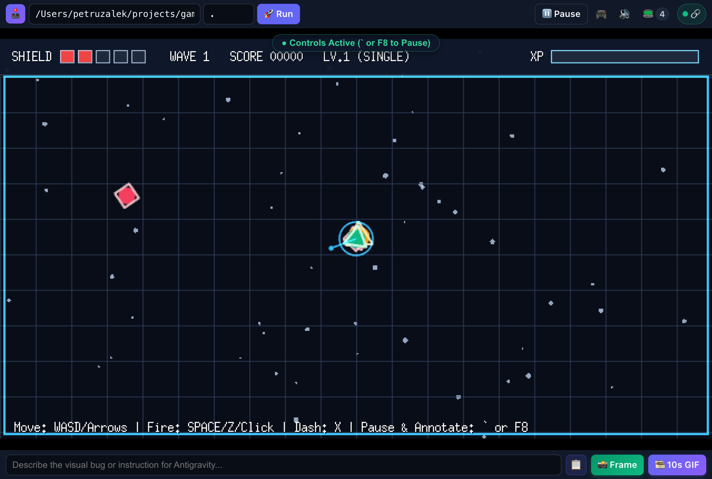
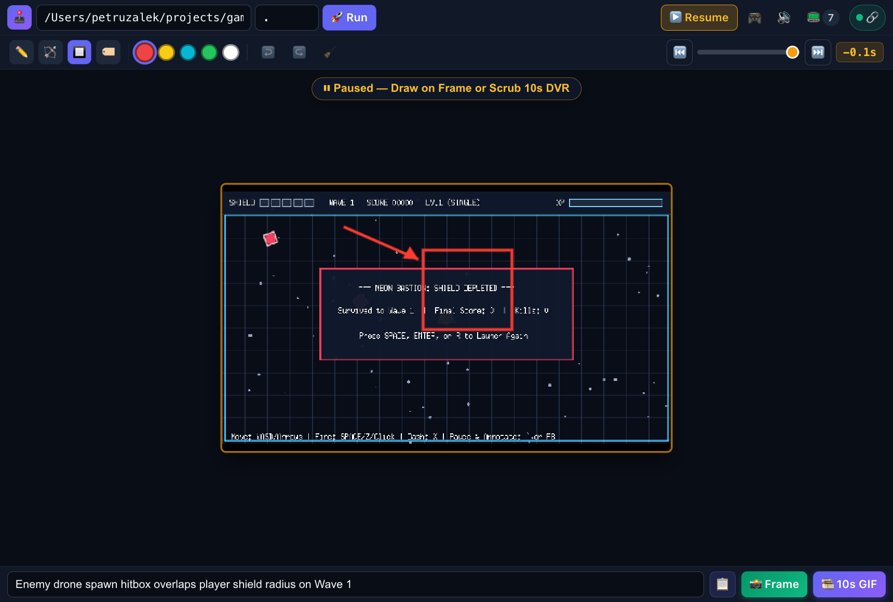

# Game Dev Starter Kit for Google Antigravity

Build, paint, compose, and playtest 2D games in Go with [Ebitengine](https://ebitengine.org/) and Google Gemini — right inside Google Antigravity.

What started as a collection of agent skills has grown into a complete **Game Dev Starter Kit** bundling **two Antigravity UI Extension plugins**, **12 specialized skills**, and a playable WebAssembly demo game:

1. 🎮 **[Antigravity 2D Game Studio (`agy-game-studio`)](plugins/agy-game-studio/README.md)** — Live 60 FPS Ebitengine WebAssembly **Playtest Studio** side-pane extension with a 10-second (250-frame) GPU DVR rewind buffer, visual bug annotation tools, 10s animated GIF export, and 11 end-to-end game development skills.
2. 🎨 **[Antigravity Paint Studio (`agy-paint-studio`)](plugins/agy-paint-studio/README.md)** — Interactive multi-layer drawing, pixel art, `.psd` editing, and Gemini AI image refinement studio that runs inline in chat, docked in the side pane, or in a full browser workspace.

---

## Visual Tour

### 1. Playtest Studio (`agy-game-studio`) — Live 60 FPS WASM & 10s DVR Bug Reporting

Compile any Go/Ebitengine game to WebAssembly (`GOOS=js GOARCH=wasm`) with one click and play it right next to your conversation. Press `F8` or `` ` `` at any moment to pause, scrub back through the **last 10 seconds of gameplay (250 frames @ 25 FPS)**, circle visual bugs, and send either a composited **📸 Frame** or a **🎞️ 10s GIF** clip straight to Antigravity chat.

| Live 60 FPS Gameplay in Side Pane | Pause, Scrub 10s DVR & Annotate Bugs |
| :---: | :---: |
|  |  |

<p align="center">
  
  <br />
  <em>Actual 10-second animated GIF89a clip captured by Playtest Studio's GPU DVR ring buffer during Wave 10 of <code>examples/playtest-demo</code> (Neon Bastion).</em>
</p>

### 2. Paint Studio (`agy-paint-studio`) — Multi-Layer Pixel Art, PSDs & AI Refinement

Sketch game concepts, draw pixel-art sprites, edit multi-layer Photoshop (`.psd`) files, and refine artwork with Gemini presets (**Pixel Art**, **Concept Art**, **Vector**, **3D Clay**, **Anime**, **Watercolor**) without leaving your editor.

| Dockable Side-Pane Canvas | Full Multi-Layer `.psd` Workspace |
| :---: | :---: |
|  |  |

---

## Quick Start

### 1. Verify your environment

Run the pre-flight environment doctor to check Go 1.26+, `wasm_exec.js`, Node.js, `uv`, Python 3, and your Gemini credentials (`GEMINI_API_KEY` or Vertex AI ADC):

```bash
./scripts/check_env.sh
```

### 2. Install both plugins into Antigravity

Link `agy-game-studio` and `agy-paint-studio` into `~/.gemini/config/plugins/` and enable them:

```bash
./scripts/install_plugins.sh
```

*(If this is your first time installing the plugins, restart Antigravity or confirm both **agy-game-studio** and **agy-paint-studio** are toggled on under **Customizations → Installed**.)*

### 3. Build, paint, and playtest in chat

Use these slash commands in any Antigravity conversation:

- **`/vibe-game-developer`** — Start a new 2D game from scratch. Interviews you to create a `GDD.md`, architects the Ebitengine loop, generates procedural or Gemini art/music, and launches Playtest Studio.
- **`/playtest-studio`** — Open the **Playtest Studio** side pane. Try it immediately with the included demo game at `./examples/playtest-demo` (*Neon Bastion*).
- **`/paint-studio`** — Open **Paint Studio** inline in chat and in the side pane to draw sprites, annotate screenshots, or refine assets with Gemini.

---

## Included Plugins & Skills

### Plugin 1: `agy-game-studio` ([`plugins/agy-game-studio/`](plugins/agy-game-studio/))

| Skill | Slash Command / Trigger | What it does |
| :--- | :--- | :--- |
| [`vibe-game-developer`](plugins/agy-game-studio/skills/vibe-game-developer/SKILL.md) | `/vibe-game-developer` | Master orchestrator that routes across design, engine architecture, art, audio, QA, and WASM playtesting. |
| [`playtest-studio`](plugins/agy-game-studio/skills/playtest-studio/SKILL.md) | `/playtest-studio` | Launches the live 60 FPS Ebitengine WASM Playtest Studio side pane with 10s DVR rewind, GIF export, and visual bug annotations. |
| [`game-design`](plugins/agy-game-studio/skills/game-design/SKILL.md) | `/grill-me` | Conducts focused game design interviews to produce a concise `GDD.md`. |
| [`ebitengineer`](plugins/agy-game-studio/skills/ebitengineer/SKILL.md) | Automatic / Go tasks | Ebitengine v2 architecture: 16:9 virtual resolution scaling, fixed 60 TPS delta-time physics, zero-allocation `Draw()`, scenes, cameras, shaders, and WASM audio. |
| [`procedural-art`](plugins/agy-game-studio/skills/procedural-art/SKILL.md) | Procedural graphics | Pure-code 2D sprites, vector shapes, color ramps, `GeoM` transformations, and pre-allocated particle pools. |
| [`sprite-animation`](plugins/agy-game-studio/skills/sprite-animation/SKILL.md) | Sprite sheets / Aseprite | Slices sprite grids, manages animation state machines (`idle`, `walk`, `attack`, `death`), and integrates Aseprite JSON/binary files. |
| [`procedural-composer`](plugins/agy-game-studio/skills/procedural-composer/SKILL.md) | Procedural audio | Pure-code 16-bit stereo PCM audio synthesis, ADSR envelopes, FM synthesis, and polyphonic chiptune BGM/SFX. |
| [`nano-banana`](plugins/agy-game-studio/skills/nano-banana/SKILL.md) | Gemini image gen | Generates and edits high-resolution sprites, tilesets, and character sheets with Nano Banana (`gemini-3.1-flash-image-preview`, `gemini-3-pro-image-preview`). |
| [`lyria`](plugins/agy-game-studio/skills/lyria/SKILL.md) | Gemini music gen | Composes 44.1 kHz stereo soundtracks and 30-second loops with Lyria (`lyria-3-pro-preview`, `lyria-3-clip-preview`). |
| [`godoctor`](plugins/agy-game-studio/skills/godoctor/SKILL.md) | Go QA & refactoring | AST verification, compiler rollback gates, SQLite test analytics (`testquery`), and Selene mutation testing. |
| [`swarm-coding`](plugins/agy-game-studio/skills/swarm-coding/SKILL.md) | Multi-agent swarm | Parallelizes orthogonal game systems across isolated subagents with disjoint file ownership. |

### Plugin 2: `agy-paint-studio` ([`plugins/agy-paint-studio/`](plugins/agy-paint-studio/))

| Skill | Slash Command / Trigger | What it does |
| :--- | :--- | :--- |
| [`paint-studio`](plugins/agy-paint-studio/skills/paint-studio/SKILL.md) | `/paint-studio` | Opens the interactive Paint Studio canvas inline in chat and as a dockable side-pane UI extension with multi-layer `.psd` support and Gemini AI refinement. |

---

## Included Demo Game: *Neon Bastion* (`examples/playtest-demo`)

Want to test drive **Playtest Studio** right away? This starter kit includes **Neon Bastion** ([`examples/playtest-demo/main.go`](examples/playtest-demo/main.go)), a zero-asset Ebitengine v2 twin-stick arcade shooter featuring procedural vector graphics, particle explosions, synthesized WebAudio SFX, wave progression, and dash mechanics.

1. Open **Playtest Studio** (`/playtest-studio`).
2. Set the Go Workspace Directory to `./examples/playtest-demo` (or `/path/to/game-dev-starter-kit/examples/playtest-demo`) and Package to `.`.
3. Click **🚀 Run** to compile and play at 60 FPS!

---

## Repository Structure

```text
game-dev-starter-kit/
├── assets/                            # Documentation screenshots & Playtest Studio DVR GIFs
├── examples/
│   └── playtest-demo/                 # "Neon Bastion" playable Ebitengine v2 WASM demo game
├── plugins/
│   ├── agy-game-studio/               # Antigravity 2D Game Studio plugin (Playtest Studio + 11 skills)
│   └── agy-paint-studio/              # Antigravity Paint Studio plugin (Paint Studio + /paint-studio skill)
├── scripts/
│   ├── check_env.sh                   # Pre-flight environment & credential doctor
│   ├── install_plugins.sh             # Links & enables both plugins in ~/.gemini/config/plugins/
│   ├── sync_plugins.sh                # Maintainer tool to sync bundled plugins with standalone repos
│   └── sync_skills.sh                 # Maintainer tool to sync skills with skills.danicat.dev
└── README.md
```

---

## Standalone CLI Tools

You can also invoke the bundled Gemini media generators and sprite slicer directly from your terminal:

```bash
# Generate or edit game art with Nano Banana
uv run plugins/agy-game-studio/skills/nano-banana/scripts/banana.py --help

# Generate 44.1 kHz stereo music tracks with Lyria
uv run plugins/agy-game-studio/skills/lyria/scripts/lyria.py --help

# Slice a sprite sheet PNG into an Aseprite JSON manifest
uv run plugins/agy-game-studio/skills/sprite-animation/scripts/slice_spritesheet.py --help
```

---

## About the Author

DISCLAIMER: I AM NOT A GAME DEVELOPER.


I am [Daniela Petruzalek](https://linkedin.com/in/petruzalek), a Developer Relations Engineer at Google. I might not be a game developer, but I am a lifetime gamer and game collector. I enjoy using projects like this to teach software engineering, agentic coding, and creative ways to build with AI.